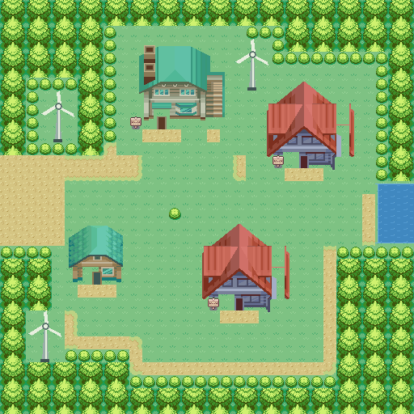

# Johto progression test ROM

Based on commit `3936a86c6d038924f4f79768ac495ab075534e0f`.
This milestone adds a playable Johto expedition. New Bark (32×32) and
Route 29 (96×32) adapt HeartGold/SoulSilver terrain, door coordinates and
west/east connections to the GBA engine. The lab, player’s home, southwest
house, rival’s home, upstairs study and Route 46 gate have separate interiors.
Community HGSS building graphics and original wind turbines distinguish the
town from Pallet. This remains the first area, not a complete Johto campaign.

Sources, artwork credits and regeneration instructions are in
[Johto map credits](../../graphics/johto/CREDITS.md). The detailed Portuguese
reconstruction specification for all ten Johto cities and Routes 29–48 is
[JOHTO_HGSS_REFERENCIA_TILES.txt](JOHTO_HGSS_REFERENCIA_TILES.txt): 33 areas,
98 original sectors, door/object coordinates, full terrain attribute grids
and 399 static scenery/building instances with their original transforms.
It includes Lake of Rage, Safari Zone Gate and Route 28 as a Mt. Silver link.



[View the complete Route 29 map](../../graphics/johto/previews/JohtoRoute29.png).

## Build and play

```sh
source /workspace/.cloud-setup/activate.sh
cd /workspace/pokeemerald-expansion
make -j5 -O all BUILD_NAME=generations-progression GENERATIONS_TEST_ROM=1
```

The [Johto test ROM workflow](https://github.com/FredericXS/pokeemerald-expansion/actions/workflows/test-rom.yml)
builds this ROM on pushes to `master`/`upcoming` and pull requests. It can
also be started manually with **Run workflow**. Open a successful run and
download **pokemon-generations-johto-test** under **Artifacts**. The ZIP
contains the playable `.gba` and its SHA-256 checksum, retained for 30 days.

Open `pokegenerations-progression.gba` in mGBA. Use a new game or a backup
of a save made by this project's schema `0x4701`; never use an original
Emerald/FRLG save. The file name keeps test saves separate from the regular
`pokegenerations.gba` build. No base ROM is required.

1. The scientist in the Pallet bedroom offers the Kanto progression
   shortcut: eight badges, League and Champion, applied immediately when
   talking. It also gives one shiny level-30 Mew (Timid, all six IVs 31;
   Psychic, Aura Sphere, Thunderbolt, Roost). Oak’s introduction remains
   available; his starter nickname prompt targets the new starter even
   with Mew already in the party.
2. Talk to the sailor near Pallet's central sign. Confirm the expedition,
   then choose Chikorita, Cyndaquil or Totodile through the reservation
   questions. Declining all three cancels without moving anything.
3. On first entry, the entire Kanto party is deposited and the reserved
   level-5 Johto starter becomes the only party member. Arrival is inside
   Elm's lab. Lab ball displays explain the reservations; they do not
   award additional starters. Elm supplies five Poké Balls, repeatably.
4. Leave the lab and walk west to Route 29. Its grass has
   level 2–4 Sentret, Hoothoot, Pidgey and Rattata. The player’s home in
   northeast New Bark provides healing from Mom, a PC and the local
   blackout/Teleport return point. The western Cherrygrove exit and northern
   Route 46 passage are visibly closed; other routes and gyms are outside
   this milestone.
5. Talking to the scientist in New Bark applies the four-Johto-badge
   shortcut and gives one shiny level-30 Celebi (Modest, all IVs 31; Psychic,
   Giga Drain, Ancient Power, Recover). This opens the PC and the sailor’s
   return passage. Kanto and Johto badge
   histories are separate and restored on travel. Fly is disabled in Johto
   until a regional Fly map exists; Teleport and blackouts stay local.
   Return visits keep the
   current party and never award/deposit another starter; the reservation
   answer on a revisit is ignored.

Each scientist gift is awarded once per region, tracked in existing saved
progression bits. If the party is full, progress unlocks and the gift waits
for a free party slot; talk again after making room. Gifts never replace a
party member or silently use the PC. Old saves that already used the
progress shortcut remain eligible for their new gift.

Without `GENERATIONS_TEST_ROM=1`, scientists give no gifts and cannot alter
progression.
Use a distinct `BUILD_NAME` for each flag configuration; Make does not
track changes to command-line compiler flags as dependencies.

## Transfer contract

First entry requires an unlocked Johto and a nonempty, valid contiguous
party. It preflights and reserves one free PC slot per party member across
all 14 boxes. A full PC, or even one fewer slot than required, aborts
without changing the party, storage, regional progress, badge flags or
respawn. Free enough slots in Kanto and retry. Existing boxed Pokémon are
never moved or overwritten.

Party copies and a new starter are staged in heap memory. All destination
writes are read back before removing the original party. A failed readback
restores every written slot, including its original empty-slot bytes.
Exact boxed data is retained: personality, OT, experience, IVs, EVs,
nature, moves, PP, held items, eggs, HP loss and status. The transfer does
not use the engine's healing `CopyMonToPC` helper. Party-only derived stats
are reconstructed normally when withdrawing. Attached mail, held mail,
active fused partners and damaged Pokémon block entry; remove mail or
unfuse first. Eggs are supported.

The transaction is synchronous: it starts no tasks, yields to no scripts,
and writes no flash. Party, progression and the local respawn are committed
before control returns to the fixed-destination warp script. Saving later
uses the engine's existing alternating flash slots. There is no schema or
storage-layout change. Automated reload coverage exercises save blocks;
it is not a power-interruption test of the flash hardware.

Until four Johto badges, this prototype locks the entire PC and return
passage. This is deliberately conservative: it does not implement
per-Pokémon regional provenance or a separate Johto-only PC. No global
battle-level cap or complete regional acquisition audit is added here.

## Validation

```sh
make -j5 -O check BUILD_NAME=generations-progression GENERATIONS_TEST_ROM=1 TESTS="Generations"
make -j5 -O check BUILD_NAME=generations-progression GENERATIONS_TEST_ROM=1 TESTS="test/save.c"
make -j5 -O check BUILD_NAME=generations-progression GENERATIONS_TEST_ROM=1 TESTS="Spikes"
```

The focused runs pass 29 regional tests, 4 save-layout tests and 4 Spikes
tests. Regional cases include all three starters through the real script
interpreter; PC full and insufficient capacity; a six-member transfer
across boxes; exact boxed data and unrelated slot preservation; eggs,
items, PP, HP and status; rollback after writes 1, 3 and 6; rejected mail,
fusions, bad checksums, empty teams, invalid starters, locked progress and
unknown schemas; duplicate calls, return and revisit; regional badge
restoration; saved-party/save-block reload; linked HGSS destination maps, one-time relocation of legacy Johto saves,
the new home’s respawn coordinates, both shiny mythical gifts, IVs/nature/
level/moves, repeat-call preservation and a pending gift with full party/PC, and receiving Mew before Oak without
losing the starter marker or selecting Mew in the starter nickname prompt.
The runner reports parametrized scenarios under their parent test count.

The test ROM occupies 26,991,724 bytes of ROM (80.44%) and is padded to
32 MiB. EWRAM remains 226,704 bytes and IWRAM 28,648 bytes. Transfer staging
uses the existing heap, without enlarging any saved structure.

The broad suite run completed with 5,439 passed, 18 known failing, 9 expected
failing and 421 TODO (5,887 total), exit status 0 and no unexpected failures.
It preceded the final Fly/Box Link/encounter-table/vacancy hardening changes;
the original focused 31-test runs were repeated against that milestone.
For the current map/gift revision, all 37 focused tests pass.
This distinction avoids treating the broad run as final coverage of those
last changes.

A button-driven mGBA 0.10.5 smoke test started a new game, used the bedroom
shortcut, obtained Bulbasaur through Oak's scene and completed the rival
battle. A synthetic full-PC fixture was then applied in emulator RAM:
the real sailor dialogue refused entry, with all 600 party bytes and
34,144 storage bytes unchanged and the player still in Pallet. Restoring
that fixture's free slots allowed travel into Elm's lab; the original
80-byte boxed Pokémon matched exactly. Walking left the lab, entered New
Bark and crossed into Route 29.

After correcting the encounter-table build guard, a scripted fixture using
the real give-mon, shortcut and transfer specials prepared a fresh Johto
save. The in-game Save command wrote a 131,072-byte flash image. A new
emulator process loaded that save with the final ROM and Continue returned
to Route 29: all 600 party bytes and the transferred 80-byte boxed mon
matched, schema was `0x4701`, and region was Johto. Walking in the grass
started a level-3 Sentret encounter. These checks are distinct from the
unit save-block reload and do not simulate power loss during flash writes.

The smoke tests above describe the previous map revision. With the HGSS
revision, mGBA also loaded that real flash save from the old vertical Route 29
and relocated the player to (93,14) on the new horizontal route. All 600
party bytes and the transferred 80-byte boxed Pokémon still matched. Walking
then crossed the west/east map connection into New Bark and entered Elm’s
new lab through its HGSS-positioned door, then reached and entered the
player’s northeast home through its separate entrance.

Old Johto saves are relocated once before loading map objects; map IDs,
party/storage layout and schema remain unchanged. Keep a backup when
updating. New saves retain their exact position on subsequent loads.

Map validation and optional regeneration:

```sh
python3 tools/generations_maps/validate.py
# Pillow is needed only for regeneration/checking graphics:
python3 tools/generations_maps/generate.py --check
python3 tools/generations_maps/generate.py --preview /tmp/johto-maps
```

The validator checks reciprocal connections, all five town doors and their
return warps, NPC reachability, both directions of the route’s ledges, the
gate approach, closed unfinished exits, complete trees, interior NPC/PC
access and GBA tile budgets. The build
Action runs this validator before compiling. Every artifact includes its
own SHA-256 checksum.

Current map/gift revision ROM SHA-256:
`a8c367a953aa7ba17c2ed5e057648a97f605648af05ec184b3bdae20d3dcb81d`.

The visual cleanup removes disconnected neighboring sprite fragments and
flat gray shadow rectangles from the community crops, aligns Elm’s doorway
with its facade opening, reuses the painted exterior stairs, separates open
water from shoreline tiles, completes forest-edge trees and repairs paired
bookshelf/table pieces. The route gate has service desks, not a kitchen.
The validator checks all six interiors and their interaction approaches.

Regenerate the complete research text from its pinned external source checkout:

```sh
python3 tools/generations_maps/export_hgss_reference.py /path/to/pokeheartgold
```

The text distinguishes exact source data from artistic reconstruction notes.
It does not claim that collision attributes identify every DS texture, or
that the documented future areas are already playable.

A further mGBA 0.10.5 run loaded the old Route 29 flash save, verified all
600 party bytes and the transferred boxed Pokémon before the gift, walked
to the Johto scientist and received level-30 Celebi. The starter and boxed
Pokémon remained byte-for-byte identical. After walking into the repaired
lab, the in-game Save command wrote a new 128 KiB flash image. A new emulator
process using the final ROM continued at the exact saved lab position (6,6),
with all 600 party bytes and the boxed Pokémon matching. Walking back and
talking to the scientist did not duplicate Celebi. These were real button
interactions and flash-save reloads, not injected gift results.

Visual smoke captures: [repaired coastline](../../graphics/johto/previews/ShorelineInGame.png)
and [Elm’s lab](../../graphics/johto/previews/ElmLabInGame.png).

The final ROM was also checked with the earlier untouched flash slot recovered
into a separate legacy-save fixture: Continue relocated the old vertical-route
position, and one scientist interaction immediately awarded level-30 Celebi
while preserving the original starter and boxed Pokémon.
